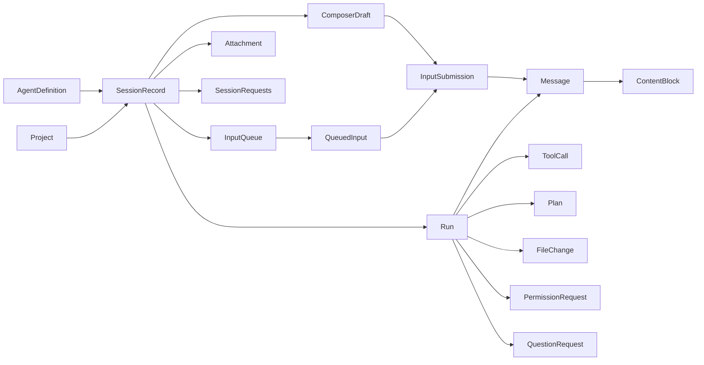

# 共享业务对象：身份与生命周期（Issue #3）

`workbench-core` 是 UI、Runtime 和 Storage 共同引用的业务类型来源，不依赖 GPUI、ACP、Tokio 或 SQLite。本文记录 #3 对象基础；#4 的命令/事件、唯一 reducer、快照和服务接口见 [共享契约](contracts.md)。

对应 R-15、R-16、R-17、R-20、R-21、R-49、R-50、R-57、R-58、R-62；为 AC-04、AC-14、AC-19 提供类型基础，**不表示这些真实运行验收已通过**。

## 身份、版本和边界

- `ProjectId`、`AgentId`、`SessionId`、`RunId`、`MessageId`、`ContentBlockId`、`ToolCallId`、`RequestId`、`AttachmentId`、`AttachmentBlobId`、`FileReferenceId`、`FileChangeId`、`PlanId`、`PlanStepId`、`QueuedInputId`、`SubmissionId`、`ResponseAttemptId` 是不同的 UUID 新类型。创建对象时分配一次，保存/恢复后沿用；路径、标题、列表位置都不是会话身份。`new()` 仅用于创建，不用于恢复或重放。
- `ExternalSessionId`、`ExternalRunId`、`ExternalMessageId`、`ExternalToolCallId`、`ExternalRequestId`、`ExternalSubmissionId` 是 Agent 标识；`AgentOptionId`、`AgentCommandId`、`AgentFieldId` 也是 Agent 提供的值。它们不是本地 UUID，不跨 Agent/会话直接比较。协议有不同 ID 表示时由适配器无损编码，core 不解释 ID 文本。
- `RunContext { session_id, run_id }` 是消息、工具、计划、差异与请求的必要归属。请求还带 `RequestContext { id, run, epoch, external_id, created_at, tool_call_id }`；不能靠当前选中会话路由。
- `ConnectionEpoch` 是会话持久化的单调连接代次。初始 0 表示尚未连接；每次新建/重连前递增并保存，包括应用重启。溢出必须报错，不能绕回或复用。外部 ID 相同也不能把旧代次请求发送到新连接。
- `Timestamp` 是 UTC Unix 毫秒，由业务所有者提供；模型不读时钟、不执行 I/O。
- 独立保存/交换对象时使用 `Versioned<T> { model_version: 1, record: T }`。业务版本与 crate 版本、数据库迁移号及 ACP 版本分开。缺失或不支持的版本拒绝读取，不按当前版本猜测。嵌套对象沿用外层版本。枚举 JSON 使用 `kind` 与 `snake_case`，ID 为字符串，时间为整数，路径采用 serde 的平台路径文本编码。
- 可空字段不代表操作成功：外部 ID 的 `None` 表示尚未得到映射或 SDK 未暴露该 ID；生效配置/能力的 `None` 表示未确认；文件增删计数、图片尺寸和附件长度的 `None` 表示未知。必填对象归属不使用 `Option`。
- 公共记录使用 `#[non_exhaustive]` 和构造器；行为身份（如会话绑定）使用私有字段与读取方法。记录不是数据库行或协议 DTO；两端可以有自己的格式，但必须显式转换并验证所有者和引用。

## 对象关系与更新所有者

箭头表示业务所属或引用，不要求装入一个大结构体。`SessionRecord` 不嵌入所有历史、附件和队列；各记录可分开查询。共享业务状态只由 core 的业务所有者维护，UI 持有读取投影和视图状态；不得另建同义 Session、执行状态或队列状态机。

| 对象 | 创建和字段更新者 | 归属与结束/删除时机 |
| --- | --- | --- |
| `Project` | core 处理用户打开目录；Storage 保存索引 | `directory` 是所有同项目会话共用的实际目录；不生成隔离目录。移除只删除索引及其本地会话 |
| `AgentDefinition` | Registry/发现模块转换后交给 core | 保存名称、来源、分发 ID/版本/平台和发现状态；发现安装不等于已认证或可用连接，不存凭据 |
| `SessionRecord` | core 创建；Runtime 反馈外部映射/连接/配置/能力；Storage 恢复已登记记录 | 永久绑定 `project_id`、`agent_id`；切换 Agent 创建新会话。`SessionOrigin` 仅 `WorkbenchCreated`；得到外部创建结果后登记 `ExternalSessionBinding`，恢复只查询登记 ID |
| `Run` | core 预分配本地运行身份；Runtime 反馈启动与实际结果 | 固定 `RunContext`、原派发 `epoch`；`started_at` 仅在实际开始时填写，开始前失败允许为空；新一轮用新 ID。终止后保留历史，随会话删除 |
| `Message` / `ContentBlock` | core 创建用户输入记录，Runtime 映射 Agent 内容；Streaming 增量由后续状态更新器合并 | 必属一次运行；外部消息 ID 可暂缺。用户消息用 `submission_id` 追溯提交，显示状态不代替接收回执。块 ID 流式更新时稳定；完成或中断保留已有正文，不删 Agent 原文 |
| `Attachment` | 平台/Runtime 提供来源与元数据，Storage 回写托管 blob 状态 | 属于会话，可被草稿、队列、提交快照、消息、工具同时引用。`Pending/Failed/Missing` 仍保留元数据供恢复或重试；字节存应用数据目录 |
| `FileReference` | core 在用户选文件时分配 ID | 指向项目与文件位置，可带一基、闭区间行范围；项目文件仍归用户所有，不能当作托管附件清理 |
| `ToolCall` | Runtime 提供名称、参数、结果、状态和输出 | 属于运行及事件来源代次，可有外部工具 ID。JSON 参数/结果不拍平成字符串；运行中工具可与多个请求并存 |
| `Plan` / `PlanStep` | 仅 Runtime 从真实计划更新映射 | 属于运行/代次；步骤 ID 不用当前位置。普通文字计划仍保留为文字，不能猜测成结构化执行计划 |
| `FileChange` | Runtime 从 Agent 报告映射 | 属于运行/代次，显式 `AgentReport` 来源与可空工具引用。未知计数不写 0；差异支持 Unified、Binary、Unavailable。不把共用目录整个 Git diff 认作本会话修改 |
| `PermissionRequest` / `QuestionRequest` | Runtime 创建请求，core 保存用户响应意图，Runtime 回填 SDK 交付结果或失效 | 必带本地请求 ID、会话/运行、代次；external_id 可空。Runtime 可按本地 RequestId 保存 SDK responder/oneshot 回调，不制造外部 ID。有效期不取决于控件是否仍显示。权限对象/范围/选项和问题字段均来自 Agent |
| `ComposerDraft` | core 保存会话的输入和配置意图；每次内容/配置编辑增加 revision | 每会话一份；切换会话/发送失败不丢内容。光标、输入法组合、菜单、焦点、滚动、展开状态不入业务记录 |
| `InputQueue` / `QueuedInput` | core 根据用户排队/编辑/取消维护 | 队列属于会话，Vec 顺序是用户顺序，条目 ID 稳定。配置与结构化输入是入队快照；编辑不修改已派发快照 |
| `InputSubmission` | core 在派发前保存，Runtime 回填真实回执 | 独立 SubmissionId 贯穿草稿/队列、会话、目标运行和消息；发送后快照不随草稿改变。只有明确拒绝后才能安全重新决定派发方式 |

`InputPart` 只允许文字、附件、文件引用和 Agent 指令，不能把工具结果/权限控件当用户输入。消息内容还支持图片、工具、计划、差异和 `Unsupported { type_name, payload }`。输入到用户消息的转换保留附件/文件/指令身份；未知结构由适配器显式变成 Unsupported，保留可诊断信息，不执行脚本或任意 UI。

## 状态事实各自独立

1. `SessionRecord.connection` 包含代次与 `NotStarted / Starting / Authenticating / Ready / Disconnected / Failed / Closed`。连接 Ready 不能证明某次提交成功；断连也不等于任务已取消或已失败。
2. `SessionRecord.current_run_id = None` 表示空闲；引用的 `Run.state` 是执行状态的唯一来源。`Starting / Running / Cancelling / Completed / Cancelled / Failed / Interrupted / OutcomeUnknown` 不与连接状态或请求集合混合。已结束的 Run 留在历史，当前引用可清空；不再复制一份 Session 执行枚举。
3. `SessionRequests` 分别保存权限和问题记录。`waiting_ids()` 从各记录状态派生集合，不另存会漂移的 waiting 标志。同一会话可以工具 Running、两个审批待处理、一个问题待回答同时成立。两个 map 的键必须等于内部 RequestId，且不能跨 map 重复；所有记录必须属于集合的 session_id。

`Cancelling` 仅记录取消请求与时间，不伪装成 `Cancelled`。`Completed/Cancelled/Failed` 是确认结束；`Interrupted/OutcomeUnknown` 是执行无法确认，不能自动启动下一条。`ExecutionState::is_terminal()` 只判断确认结束，**不决定是否允许继续队列**。

请求状态为 `Pending → Submitting → ResponseSubmitted`，也可明确 `ResponseRejected`、`OutcomeUnknown` 或 `Invalidated`。`ResponseSubmitted` 只表示响应已成功交给 SDK/协议响应通道，因此不再等待用户答复；它不表示 Agent 另发了二次 ACK，也不证明被授权的操作已执行。不能依赖协议未承诺的确认事件。明确未交付可记录 ResponseRejected；结果未知时先核对，不重发。`is_actionable()` 只表达本条状态允许响应，最终还须验证会话、运行、代次一致，以及运行未取消/终止。失效记录不能复活：运行结束、取消、断连、替换、会话删除、Agent 撤回或过期均有独立原因；重连如 Agent 再次发问，分配新本地 RequestId，保存旧记录。SDK 回调属于 Runtime 的临时资源，不序列化；重启读取请求历史不能恢复可点击的旧回调。

权限选项 ID 取自 Agent；允许/拒绝的语义和范围仅供显示与传递，工作台不建立第二套访问政策。提问可表达文本、单选、多选及多个字段组成的表单；响应按 AgentFieldId 回传。必填、选项有效性、自填许可和单/多选数量由 #4 的业务校验按真实 schema 判断，序列化本身不是完整业务验证。#4 另有 Declined、保留原 schema 的 Unsupported 字段和 secret 标记；未知 required 不能静默省略。

## 配置与能力

- `RequestedConfiguration` 是用户意图；默认 `PermissionSelection::DefaultFullAccess`，不是虚构的 `full-access` Agent ID，也不意味着实际权限。明确选项用 `AgentOption { id }`，不得自动覆盖用户后来的选择。
- `PendingConfiguration` 是已发出请求的冻结快照，带 RequestId、代次与真实等待时机（AwaitingAgent/AfterRun/NextRun/AgentReported）；用户最新 requested 可与 pending 不同。
- `EffectiveConfiguration` 仅由 Agent 确认，包含代次、能力 revision、确认时间；确认前为 None。Agent 拒绝用 `ConfigurationRejection` 保留请求快照及原因，旧 effective 不因此改成新请求。工作台不越过组织或 Agent 的限制。
- `AgentCapabilities` 按会话连接代次和 revision 维护。模型、模型内思考档位、权限和指令均使用 Agent 提供的 ID；图片/文件及限制、提问种类、steering、会话恢复、活跃运行恢复、运行中修改配置分别表达。Unknown 不等于 Unsupported；未知附件限额不等于无限。
- 模型改变后重新读取适用能力；旧模型的 effort 不能直接沿用。保存的 requested/队列快照不是发送许可，派发前重查能力、选项、附件限制和实际配置；旧代次的 effective/capabilities 可读但不能当作当前已确认值。

## 输入、提交与队列

入队只是本地保存，不等于 Agent 接收；`QueuedInput::from_draft` 与 `InputSubmission::from_draft/from_queued` 复制内容及配置快照，后续草稿修改不改变它们。`QueuedInputState::Editing` 是持久的派发阻止状态，恢复时仍保持可编辑，不能因编辑窗口消失自动执行。

队列从 Waiting 经 Dispatching 指向 InputSubmission，只有真实 Accepted 才标 Submitted；Cancelled 保留取消时间，后续可清理记录。Prepared、AwaitingAcknowledgement、Accepted、Rejected、OutcomeUnknown 是不同的提交状态。`StartRun` 先保留本地 RunId；`SteerRun` 指向原 RunId。Accepted 的 run_id 必须与 intent 及所属会话相符。提交结果未知不能换 ID 盲重试，也不能因“当前轮刚结束”猜测把补充再发成新一轮。

同一会话只能在前一轮明确结束、队列 Ready、头部条目未编辑/派发、能力重新有效时按序派发；不同会话互不阻塞。停止、失败、断连、应用重启、结果未知时暂停未发送队列，并保留原因和内容；由用户明确继续。`QueueDispatchState::Ready` 是队列自身的条件，不等于 Runtime 已可派发。上述调度与校验行为在 #4 及后续服务实现，本项仅提供完整事实类型。

## 恢复与删除

恢复有三件独立的事：`HistoryAvailability` 表示本地记录是否可读；`SessionResumeState` 表示能否打开已登记的原外部会话继续对话；`RunRecoveryState` 表示能否重新挂接原来进行中的运行。历史 Readable + 会话 Resumed + 原运行 Interrupted/恢复 Unavailable 是合法组合，不显示成任务继续执行。

重启先读本地记录，队列暂停为 ApplicationRestart；旧连接 phase、能力和配置确认只能作为历史，不能直接恢复为 Ready。未确认结束的旧运行标为 Interrupted 或 OutcomeUnknown，再根据 Agent 实际能力核对。恢复会话与活跃运行都使用新代次，保留 Run 原派发 epoch；后续事件路由还要验证明确的 `RunRecoveryState::Recovered { epoch }`，不能接受任意新代次改写旧运行。不会扫描或导入其他客户端的 Codex 历史。

删除是本地生命周期：

- 先确认/停止受影响的正在运行任务，确认不能再派发及资源已处理，再移除会话和子记录；取消中/结果未知不能冒充已经安全停止。协调流程由后续业务服务实现。
- 删除会话清理其运行、消息/块、工具、计划、差异、请求、草稿、队列、提交和附件记录；先使旧请求失效，晚到事件不能重新创建已删除会话。
- 移除项目连同其本地会话索引处理，不删项目目录或文件引用目标；删除本地记录不默认调用 Agent 的全局历史删除接口。
- 只有应用明确拥有、且不再被任何保留的草稿、队列、提交、消息或工具引用的 blob 才能回收。`AttachmentStorage::Managed` 以 opaque blob ID 标记应用所有权，Storage 决定应用目录中的实际路径；ImportedFile 的 original_path 永远不是可删除附件路径。
- 修改业务 schema 时由契约负责人同步类型、版本、转换、样例与使用方。#4 将补充应用这些约束的状态更新和回放验证；本项不声称仅靠公开记录反序列化就能校验整张对象图。

## 已有代码与文档边界

Spec 的概念表包含 AgentEvent；#4 以 Event/EventEnvelope 和 JournalRecord 提供该契约，详见 contracts.md。Spec 举例的 Idle 在本实现由 `current_run_id = None` 表达，避免与 Run.state 重复保存；其余执行事实保留独立表达。README/task-plan 的阶段性状态由主控随集成更新，本任务不修改这些共享文件。

`tests/serialization.rs` 使用虚构中文项目路径、托管 PNG、多个同时等待请求、运行工具、队列编辑后快照、未知提交、配置三个阶段及恢复区别，做少量序列化往返检查；不连接 Agent、窗口或数据库。
