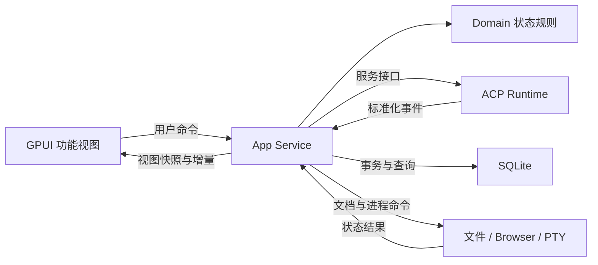

# Agent Workbench · 架构与接入方案

本文件是支撑[产品规范](workbench-v1.md)的工程决策。它描述正式实现的边界，不表示已经有对应 Rust 源码。先落实[统一数据契约](data-contracts.md)，再开发具体视图与服务。

## 1. 技术基线

| 层 | 决策 | 验证与约束 |
| --- | --- | --- |
| 原生 UI | Rust + GPUI，通用控件优先 gpui-component | 通过当前 GPUI Kit facade 使用对应组件；验证依赖来源和统一版本，避免混入不兼容 GPUI 类型 |
| 组件与视觉 | gpui-component + 自有业务组合 | 优先复用输入、选择器、菜单、Tabs、Tree、Editor、Dock/Resizable、TextView；业务结果卡和终端属于应用组件 |
| Agent 通讯 | ACP Rust SDK，首个真实接入 Codex ACP adapter | 首期按发布版本与协商的协议能力锁定；2026-11-05 查到 v1 Latest、v2 Draft，不能混用字段 |
| 后台 I/O | Tokio + 受控事件通道 | 文件、进程、网络、数据库工作离开 UI 渲染线程；GPUI 状态更新回到对应上下文 |
| 持久化 | SQLite + 应用数据目录 | 版本化迁移；消息/队列/索引事务；大附件保存为文件 |
| 网页 | GPUI WebView 平台集成 | Windows WebView2、macOS WKWebView；真实窗口验证层叠、输入、隐藏和连续缩放 |
| 终端 | 原生 PTY + 终端解析与绘制 | Windows ConPTY / Unix PTY；选用已维护实现并验证 ANSI、尺寸、Ctrl+C，不能用普通 stdout 文本框替代 |
| Git / Issues | 仓库服务、GitHub 只读接口 | 原型固定内容替换成实际来源；首期复用用户已有认证方式，记录缺少依赖/权限状态 |

开始实现时记录工具链、平台 SDK、gpui-kit/gpui-component 来源、ACP SDK、适配器、WebView 与终端库的确切版本。当前文档页示例版本不是已编译依赖锁；编译后提交锁文件与最小启动说明。

## 2. 模块与依赖方向

模块按职责明确，再按规模决定是否独立为 crate。下面是模块边界，不要求一次创建大量空 crate。

| 模块 | 负责 | 不直接拥有 |
| --- | --- | --- |
| `app` | 初始化、窗口与服务组装、Root、生命周期 | 某个功能的长业务流程 |
| `domain` | 纯 Rust 实体、ID、命令/事件、状态与不变量 | GPUI Entity、原始 JSON-RPC、SQLite 连接 |
| `app-service` | 调度、提交受理、队列、状态转换、配置协调、持久化事务安排 | 绘制与控件焦点 |
| `agent-runtime` | ACP 进程、协议握手、认证、能力与事件转换、取消及释放 | 对话组件与项目选择控件 |
| `registry` | 元数据获取/缓存、安装发现、安装计划与验证 | 自行决定执行未知安装脚本 |
| `storage` | SQLite schema/迁移、读写、附件目录、恢复查询 | UI 布局和 Agent SDK 类型 |
| `platform` | 托盘、窗口控件、剪贴板、目录选择、进程组、系统能力 | 某家 Agent 的业务协议 |
| `ui-foundation` | Token、图标、控件组合、语义状态样式 | 独立复制的业务状态 |
| `workspace` | Sidebar、顶部标签、面板布局、设置路由 | shell 与 Agent 的实际执行 |
| `conversation` | 消息、结果块、Composer、选择器、审批、阅读锚点 | 原始 ACP 通讯 |
| `files` | 文件树、文档、版本/冲突、Git 差异视图 | 会话状态机 |
| `browser` | 网页对象、导航、多页视图与 WebView 生命周期 | 应用通用业务命令桥接 |
| `terminal` | PTY、解析缓冲区、终端视图与终止流程 | 从“关闭视图”推断“杀进程” |
| `settings` | 设置分类、编辑、校验和保存 | 第二份会话/配置真值 |

功能模块可以各自保留 model/view/actions/dialog 文件，跨模块只通过公开契约通信。`app` 负责依赖注入，`domain` 处于稳定底层；`app-service` 依赖服务接口，实际适配器在组装层注入。

图中回传是事件流，不是 Rust crate 的反向依赖。

## 3. GPUI 状态与布局

- 每个窗口只建立一个组件 Root，统一管理弹层、焦点和窗口级设施。
- 会话输入、消息滚动、文档编辑器、网页和终端视图保留稳定 Entity；普通卡片/行用轻量组合。`render` 只读状态并生成元素。
- `SessionId / DocumentId / BrowserPageId / TerminalId / TabId` 派生稳定 ElementId，避免排序、过滤、换标题后丢失控件状态。
- 会话领域数据归 App Service；光标、焦点、悬停、局部展开、滚动句柄归功能视图。配置选择显示源来自同一已确认配置模型。
- 多个入口共用同一个 Action/命令：按钮、菜单、快捷键不会各自实现不同的保存或停止逻辑。
- 长会话与消息列表虚拟化；可变高度消息保留稳定锚点。批量文本增量可合并为一帧更新，关键审批、错误与完成事件不能被丢弃。
- HTML 样例代码只有外观参考作用；正式 gpui-component 组合使用它自身的焦点、弹层、键盘和生命周期能力。

推荐映射：

| 产品区域 | 框架基础 | 应用自有部分 |
| --- | --- | --- |
| Sidebar / 标签 / 工具栏 | Sidebar、TabBar、Button、Menu | 项目筛选、内容标签身份、运行状态 |
| 面板布局 | Dock / Resizable | 单辅助区策略、放大前布局、视图与进程生命周期 |
| Composer | Textarea、Attachment、Popover、Combobox / Select | 草稿、附件准备、能力选择、补充与队列 |
| 消息 | Message / TextView / MessageScroller | 标准化内容块、结果来源、审批与工具过程 |
| 文档 | Tree、Editor、Diff | 文件版本、保存事务、脏缓冲冲突 |
| 设置 | Tabs/导航、Switch、Input、Select、Dialog | 分类路由、值校验、服务配置 |
| 网页与终端 | WebView 集成 / 自定义终端元素 | 网页状态、PTY 绑定、输入输出、真实平台行为 |

组件名是选型方向；具体 Rust 签名必须检查锁定版本源码。官方 [Dock](https://gpui-kit.com/component/dock/) 支持分区与放大；[MessageScroller](https://gpui-kit.com/component/message-scroller/) 支持消息滚动基础，应用仍拥有消息身份和未读规则。

## 4. Agent 与配置接入

1. Registry 只提供候选信息；校验来源、可执行文件、当前平台、版本和启动参数。
2. 安装前显示明确的目标与动作，按用户决定执行。已安装直接发现并验证。
3. ACP stdout 只用于协议，stderr 单独收集为诊断；单个日志行不能污染协议解析。
4. 初始化得到协议版本和能力；认证按 Agent 返回方法执行。凭据优先留在 Agent/系统凭据设施。
5. 新建/恢复会话后读取配置选项、模式、命令与图片能力。保留协议原始标识，UI 使用可读标签。
6. 标准字段统一转换；扩展在 Runtime 的适配边界内协商，UI 不识别某个 `_meta` 私有键。
7. Codex 当前适配器来源是 `agentclientprotocol/codex-acp`。旧 `zed-industries/codex-acp` 已归档并指向新仓库；安装来源需用当前维护路径。[当前仓库](https://github.com/agentclientprotocol/codex-acp)、[旧仓库说明](https://github.com/zed-industries/codex-acp)

工程默认每个活跃应用会话拥有独立的运行实例与取消边界；两会话可共享目录但不共享可变消息状态。若后来用单进程多会话优化，必须证明其多路复用和取消不会串会话。

发送、补充、配置和取消的完整应用状态定义只维护在[数据契约](data-contracts.md)。特别是 ACP 普通 Prompt 的最终响应不等于早期接收 ACK；本地可靠保存与 Agent 接受分开表示，避免锁住 Composer 一整轮或断线重复发送。

## 5. 文件、网页与终端服务

### 文件服务

按项目规范化路径查找文档，保存来源版本与当前缓冲区版本。目录观察与 Agent 文件事件去重，外部变更进入同一文档状态机。真正保存先校验版本，再提交，成功后更新干净基线。别名/符号链接和项目边界按真实解析路径处理，避免同一文件产生互不知晓的两个缓冲区。

### WebView

每个网页保留一个原生视图实例。布局变化更新边界，隐藏时明确隐藏原生 child view，返回时重新显示；只有关闭网页释放实例。

官方把 `gpui-webview` 标为实验性。Windows 原生子视图在层叠、裁切与 GPUI 弹层之间有约束，不能假设外层容器的圆角/透明度直接作用于网页。早期验证地址输入、切页、弹窗、菜单、连续拖宽、最小化恢复；必要时使用可靠的原生层叠或临时隐藏网页以保证操作正确。恢复时保持同一网页实例。[官方平台说明](https://gpui-kit.com/docs/webview/)

网页导航与工作台命令分离；未知外部 scheme 交给平台可用性判断并给出明确行为。证书/加载失败在该网页中反馈，不替换整个工作台。

### PTY 终端

终端服务拥有 shell、PTY 句柄、读写任务和退出状态；视图拥有选择和滚动。尺寸变化发送实际行列数；按终端语义编码键盘和 Ctrl+C；stdout/stderr 的终端字节流交给解析缓冲区而不是按行追加为普通日志。

Windows 的 ConPTY 会话和通信通道需要在启动子进程前建立；实际库选型应在小型验证中覆盖进程树清理。[Microsoft ConPTY 文档](https://learn.microsoft.com/en-us/windows/console/creating-a-pseudoconsole-session)

后台大输出使用有界缓冲与流量控制，回滚历史上限可以配置。应用退出必须停止所拥有进程并关闭句柄；只关标签保留服务对象。

## 6. 持久化与资源拥有者

- SQLite 在后台串行写入/短事务；schema 使用显式版本迁移，不能用 `CREATE TABLE IF NOT EXISTS` 代替旧库升级。
- 保存元数据与事件投影，图片等大内容按应用附件 ID 存文件；引用计数/清理按草稿、消息和队列实际引用处理。
- Layout 版本独立，恢复尺寸按当前窗口钳制；无效文件/网页/会话引用能恢复为可处理的状态。
- Domain 只描述身份与状态；实际进程、PTY、WebView、数据库连接由对应服务生命周期持有。
- 隐藏窗口和路由切换不会销毁 App Service。退出遵循“停止新接收 → 处理脏文件 → 取消运行 → 释放资源 → 持久提交 → 退出”。

## 7. 集中开发的推进顺序

| 阶段 | 产出 | 进入下一阶段的证据 |
| --- | --- | --- |
| S0 统一契约 | Domain 类型、事件/命令、状态不变量、确定性示例数据 | 前后端使用同一契约；并发、队列、取消、配置和保存边界可评审 |
| S1 原生与平台底座 | 可复用的 GPUI 窗口、执行器及 ACP/WebView/PTY 接入边界 | 选择真实 API 与平台依赖；仅对阻塞后续实现的关键疑问做短检查，不另建演示或测试工程 |
| S2 原生视觉基础 | Token、Root、Sidebar、标签、面板、设置、结构化对话 | 对照已确认 HTML，窗口尺寸/焦点/滚动正确；使用明确标识的开发示例数据 |
| S3 数据与服务 | SQLite、项目/会话、文件/Git、浏览器多页、终端生命周期 | 实际文件保存、重启恢复、多对象隔离；组件不是空壳 |
| S4 Agent 工作闭环 | 配置、图片、流式、补充、队列、审批、停止、异常 | 两会话真实并行，配置与接收状态准确，取消不影响另一会话 |
| S5 整合验收 | Issues/用量、托盘、安装/认证异常、打包 | 逐项通过产品验收场景并记录实际证据 |

S0 契约先完成。随后依赖允许的功能可交错推进，但产品代码统一由主 Agent 实现；子 Agent 只做探查、API 核实、错误定位和独立审阅。探查必须交付真实依据，不另写产品实现。只有无法确定真实接入路径时才做最小检查；完整必要验证集中到 S5 / T12，避免每个功能重复测试或截图。

## 8. 有限而有效的验证

- 最终集中检查优先覆盖旧事件串流、配置版本、未知送达、队列编辑竞争、取消与审批、文件冲突、schema 迁移保留数据。
- 收尾的集成检查覆盖真实 ACP 初始化/配置/图文/取消，真实文件读写，WebView 和 PTY 生命周期。
- 收尾的界面检查覆盖最小尺寸、键盘、焦点、中文输入法、流式阅读锚点、文本选择、面板连续缩放；与已确认截图/原型对照。
- 开发阶段集中实现，只在编译错误、实际故障或关键阻塞时做最小检查；T12 集中运行必要的格式、Clippy、相关状态/持久化检查和真实使用流程，不要求每个 Issue 新建测试、截图或全量构建。
- 构建通过、示例演示、真窗口、真 Agent、用户验收分开记录。尚未验证的能力明确留在验收记录中。

## 9. 尚待工程验证的事项

| 验证项 | 处理方式 |
| --- | --- |
| 适配器版本的补充/图片/恢复能力 | 锁定版本并握手；用真实操作证明语义。能力不支持时按产品规范显示不可用，不能替换成伪行为 |
| 完整访问到实际权限模式的映射 | 读取选项并提交，核对真实生效值；记录 Agent 不可支持的情况 |
| WebView 在 Windows 中与 GPUI 弹层共存 | S1 真窗口验证；失败时先修平台适配，再继续依赖此能力的任务 |
| 原生终端选型与 CJK/ANSI 行为 | 验证 shell、Ctrl+C、调整大小、中文和长输出；按实际证据选择库 |
| macOS 平台发布 | 独立验证窗口按钮、IME、托盘/菜单栏、WebView、PTY 与打包；不把 Windows 验收当作跨平台验收 |

以上均是实施检查项。若验证证明必须改变已确认的布局、主要功能或数据安全语义，再向用户说明具体影响；普通库选择和内部实现由开发者处理。
